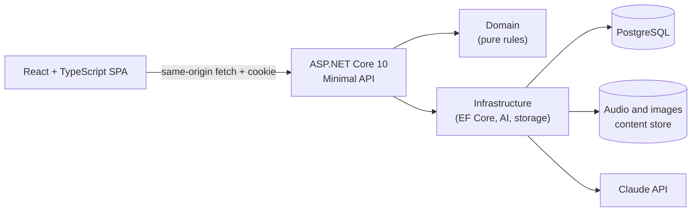

# egzamin-b1

Preparation platform for the Polish state certificate exam at level B1, built for Ukrainian and Russian
speakers living in Poland. It runs the full mock exam in the real format, grades the written and spoken
parts with AI against the exam board's criteria, and turns every mistake into spaced-repetition practice.

**Live:** [egzamin-b1.pl](https://egzamin-b1.pl) (the landing page has a short demo video).

This repository is the product's source code. Exam content (exam sets, recordings and pictures) is **not**
included; see [Exam content](#exam-content).

## What it does

- **Full mock exam:** Słuchanie (listening), Czytanie (reading), Gramatyka (grammar), Pisanie (writing),
  Mówienie (speaking). Each part has its own timer and a 50 % pass threshold. Answers autosave.
- **Automatic grading** of closed tasks in the domain layer: exact match for choices, normalised comparison
  for typed answers, and a "check it yourself" state for near misses.
- **AI review of writing** on the exam board's five criteria. Errors are highlighted in the text, each with a
  correction, a short rule and a contrast with the learner's own language.
- **AI-assisted speaking:** a step-by-step flow with browser speech recognition. The role-play examiner adapts
  each line to what the candidate said, and falls back to a script when AI is unavailable.
- **Error bank:** mistakes from grammar and writing are grouped by topic and come back in a daily blitz until
  they are solved three times on different days.
- **Teacher groups:** invite links with expiry and usage limit, explicit student consent (GDPR), and
  per-student progress and frequent mistakes.
- Four interface languages (uk, ru, pl, en), light and dark theme, mobile layout.

## Engineering highlights

| Area | What to look at |
|---|---|
| AI integration | One `IReviewModelRunner` interface with Claude API and CLI providers. The prompt and the parser are shared, the model's JSON is validated and clamped, and verdicts and points are computed in code. `src/Infrastructure/Review` |
| Evaluation | A harness that scores the AI grader against human examiners. Criteria within ±0.5: 4/20 → 15/20; mean absolute error 0.79 → 0.45; about $0.07 per essay on Sonnet. The calibration target was not reached, and the write-up says why. [docs/evaluation.md](docs/evaluation.md) |
| Cost control | Per-user daily caps for reviews and dialogue turns. Usage is reserved before the model is called, so failed or cancelled calls count too. A per-user concurrency limit on AI endpoints. `AiUsageGate`, `RateLimitSetup` |
| Security | Cookie auth with `__Host-` cookie, same-origin check, CSP and other headers, rate limits, input size limits, no open redirect, ProblemDetails without internal details, cross-user access tests. [docs/architecture.md](docs/architecture.md#security) |
| Domain modelling | Exam grading, session scoring and the spaced-repetition rules are plain C#, unit-tested without a database. `src/Domain` |
| Tests | 389 .NET tests (domain, plus HTTP tests through `WebApplicationFactory` on SQLite) and 14 front-end tests. No database server, network or API key needed. CI runs build with warnings as errors, tests, lint and a vulnerable-package check. |

## Architecture



A modular monolith with three .NET projects (Domain, Infrastructure, Api) and a React front end served by the
same process. In production it runs as one container on Azure Container Apps with Azure Database for
PostgreSQL and Azure Files. Details, flows and trade-offs: [docs/architecture.md](docs/architecture.md).

**Stack:** .NET 10, ASP.NET Core Minimal APIs, EF Core 10 (PostgreSQL, SQLite for local runs), Anthropic .NET
SDK, React 19, TypeScript, Vite, xUnit, Docker.

## How AI grading works

1. The writing part is submitted. The attempt is marked submitted with a conditional update, so a double
   click cannot grade it twice.
2. One review is reserved against the user's daily cap.
3. The prompt holds the tasks, word counts computed in code, the checklist for each text form, scoring bands
   and the student's text, which is placed between delimiters and escaped.
4. The model counts errors by type across the whole text, picks a band per criterion with a reason, and
   returns one JSON object.
5. The code checks that all five criteria are present, clamps and rounds the scores, keeps at most 12
   annotated errors, normalises the error types and computes the verdict.
6. The errors go into the learner's error bank.

The evaluation of this grader, including what did not work, is in [docs/evaluation.md](docs/evaluation.md).

## Running it

```
docker compose up --build
```

Open http://localhost:8080 and use **Dev login**. AI review is off until an API key is provided through an
environment variable. Without Docker, run `dotnet run --project src/Api --launch-profile sqlite` and
`npm run dev --prefix src/Web`. Full instructions and the configuration reference are in
[docs/running.md](docs/running.md).

```
dotnet test
npm test --prefix src/Web
```

## Repository layout

```
src/Domain           exam model and grading, error bank, dialogues, groups, dashboards
src/Infrastructure   EF Core and migrations, AI reviewers, content store, arkusz importer
src/Api              endpoints, auth, security setup, CLI command
src/Web              React front end, i18n dictionaries, knowledge base articles
tests/               Domain.Tests, Api.Tests
tools/pisanie-eval   evaluation harness for the writing grader
tools/arkusze-import scripts that convert exam PDFs into the arkusz JSON format
content/arkusze      exam set format (no content)
docs/                architecture, evaluation, running locally
```

## Limitations

- **The AI grader is not validated.** It was evaluated on only four graded works, with no held-out set, one
  run per iteration and one model (Sonnet). The production model is a setting (`Review:ApiModel`) and has not
  been measured separately. Scores are an estimate for practice, not a prediction of the exam result.
- **Speaking** is reviewed for structure and coverage only. Browser speech recognition is not reliable enough
  to grade pronunciation or grammar.
- **One instance.** The per-user AI lock is in-process; scaling out needs a database lock.
- **No content in the repository.** A fresh clone runs with an empty exam list until you load your own sets.
- Known technical debt is listed at the end of [docs/architecture.md](docs/architecture.md#known-technical-debt).

## Exam content

Exam sets, recordings and pictures are managed separately from the code and are not part of this
repository. The code works with any exam set in the documented format
([content/arkusze/README.md](content/arkusze/README.md)). The project is independent and not affiliated with
the Państwowa Komisja do spraw Poświadczania Znajomości Języka Polskiego jako Obcego.

## License

Source-available under the [PolyForm Noncommercial License 1.0.0](LICENSE.md): you may read, run and modify the
code for noncommercial purposes. Commercial use needs written permission from the author.
