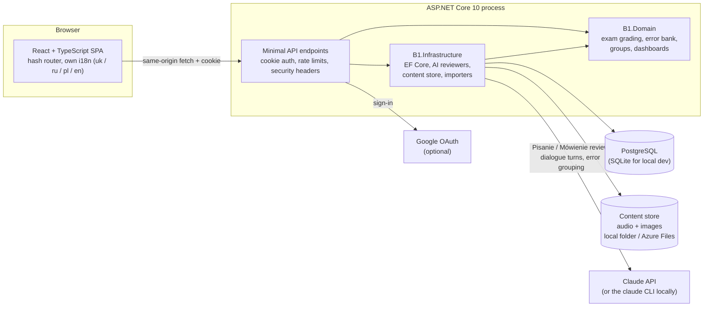
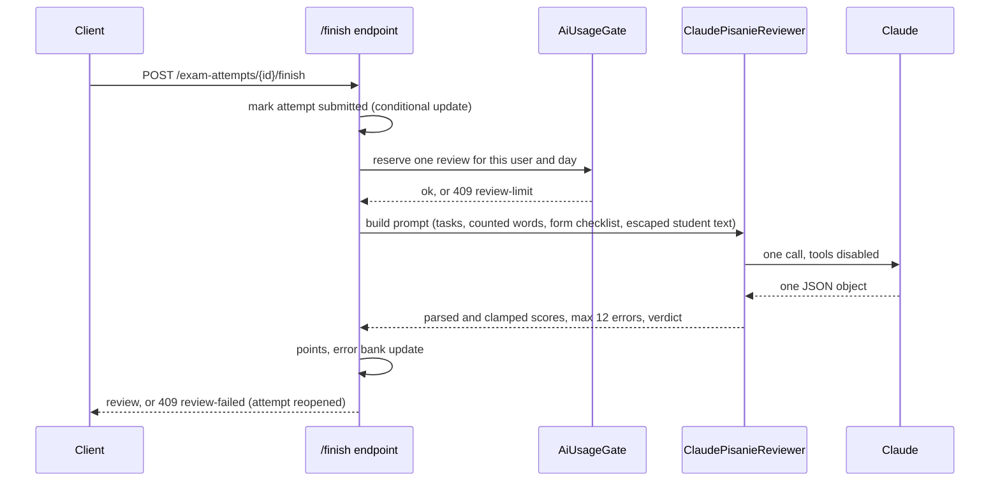

# Architecture

egzamin-b1 is a modular monolith: one ASP.NET Core process serves the JSON API and the built React app,
backed by one PostgreSQL database. This page explains the structure, the main decisions and the trade-offs.

## Projects

| Project | Responsibility | Depends on |
|---|---|---|
| `src/Domain` | Pure model and rules: arkusz (exam set) structure, answer normalisation and grading, part and session scoring, word counting, review DTOs and verdicts, the error bank (spaced repetition), dialogue scripts, groups and consent, dashboards. No I/O. | nothing |
| `src/Infrastructure` | EF Core `AppDbContext` and migrations (Npgsql), SQLite support for local runs, Claude reviewers and runners, AI usage gate, content store (audio and images), arkusz importer, group, dashboard and account services. | Domain |
| `src/Api` | Minimal API endpoints grouped by feature, auth (cookie + optional Google), rate limiting, security headers, ProblemDetails error mapping, the `seed-arkusze` CLI command, static hosting of the built front end. | Domain, Infrastructure |
| `src/Web` | React 19 + Vite + TypeScript SPA. No UI framework; hash routing; own i18n dictionaries with a parity test. | API over HTTP |
| `tests/Domain.Tests` | Unit tests of domain rules, plus service tests on in-memory SQLite. | Domain, Infrastructure |
| `tests/Api.Tests` | HTTP-level tests through `WebApplicationFactory` with a temporary SQLite database: auth, cross-user access, security, rate and size limits, media, exam flow. | Api |
| `tools/pisanie-eval` | Evaluation harness for the AI grader, see [evaluation.md](evaluation.md). | Infrastructure |
| `tools/arkusze-import` | Python scripts that turn exam PDFs the operator owns into the arkusz JSON format. | — |

## Main flows

### Mock exam

An arkusz has five parts in the real order: Słuchanie (listening), Czytanie (reading), Gramatyka (grammar),
Pisanie (writing) and Mówienie (speaking). Each part has its own timer and a 50 % pass threshold.

1. The client starts an attempt; answers autosave through a serialised queue, so a slow request cannot
   overwrite a newer one, and submitting stops if the last save failed.
2. Closed parts are graded in the domain (`ExamGrader`): exact match for choice items and normalised comparison
   for typed answers. Near misses get a `NeedsReview` verdict and the student may accept them. Only those, not
   wrong answers, can be accepted.
3. Answer keys reach the client only after the part is submitted.
4. Wrong answers from Gramatyka and Pisanie flow into the student's error bank.
5. Submission is idempotent: a conditional update on `SubmittedAt IS NULL`, so a double click cannot write the
   error bank or call the AI twice.

### AI review of Pisanie and Mówienie

- **One interface, several providers.** `IReviewModelRunner` has an API implementation (`ClaudeApiRunner`,
  Anthropic .NET SDK), a CLI one for local development (`ClaudeCliRunner`, runs `claude -p` with tools and
  MCP disabled in an empty folder), and `none`. The prompt and the parser are shared, so the evaluation
  harness tests exactly what production runs.
- **The model is not trusted.** The response must be one JSON object with all five criteria. Scores are
  clamped to 0–4 and rounded to 0.25, error types are normalised to a fixed legend, and the verdict is computed
  in code, not by the model. Student text is placed between delimiters and escaped, so it cannot close the
  data block.
- **Speaking** is reviewed for structure and coverage of a per-task checklist, not for grammar: the
  transcript comes from browser speech recognition and is not reliable enough to grade grammar.
- **Dialogue** (speaking task 3): a scripted examiner per situation; each line is adapted to what the
  candidate said by a short AI call with a 12 s timeout. On any failure or when the daily cap is reached, the
  scripted line is used, so the dialogue never breaks.
- **Error grouping:** new mistakes in the error bank are grouped by topic by the AI in batches of up to 30,
  with a short rule per group. Failures back off for 10 minutes per user.

### AI cost control

| Control | Where | Default |
|---|---|---|
| Reviews per user per UTC day | `Review:DailyLimit` | 50 |
| Dialogue turns per user per UTC day | `Review:DailyDialogTurns` | 200 |
| Usage recorded **before** the model call, kept on failure or cancellation | `AiUsageGate` | — |
| Check and insert serialised per user (in-process lock + transaction) | `AiUsageGate` | — |
| Concurrency 1 and 10 requests / minute per user on AI endpoints | rate limiter policy `ai` | — |
| Max output tokens per call | `ClaudeApiRunner` | 4000 |
| Request timeout | `Review:TimeoutSeconds` | 180 s |

The per-user lock is in-process. Running several instances would need a database lock (for example a
PostgreSQL advisory lock per user); this is noted as a limitation.

### Error bank

Every mistake becomes an `ErrorPattern` with a counter of falls. Rules (`ReviewPolicy`, unit-tested):

- 2 falls make a pattern *active*; active patterns are ordered by number of falls.
- A clean run counts only if there was no fall on the same pattern that day and the previous clean run was
  on another day. 3 clean runs in a row archive the pattern; any fall resets the streak.
- The next showing is 1, 3, then 7 days after clean runs, and the next day after a fall.
- The daily blitz has 5–8 items: due patterns first, then the most frequent, plus up to 2 archived ones as
  a check.

### Teacher groups

A teacher creates a group and shares an invite link: a 128-bit random token with an expiry date, a usage
limit and revoke. A student joins only after explicit consent to share results (GDPR). The teacher sees
per-part progress, parts below 50 % and frequent mistakes, only for consenting members of their own groups.
Account deletion removes all of the user's data in one transaction.

## Security

- Every endpoint requires a signed-in user unless it explicitly allows anonymous access; a test checks the
  anonymous allow-list.
- Every query filters by the current user; `CrossUserTests` checks that user B gets 404 on user A's
  attempts, sessions, patterns, groups and student card.
- Cookie: HttpOnly, SameSite=Lax, `Secure` and the `__Host-` prefix outside Development. State-changing
  requests from another origin are rejected.
- Headers: a strict Content-Security-Policy (`default-src 'self'`, no inline scripts), HSTS,
  `X-Content-Type-Options`, `Referrer-Policy`, `Permissions-Policy` (microphone for the page itself only).
- Rate limits: global per user or IP, `ai` per user, `feedback` per IP. Forwarded headers are trusted only
  from configured proxies.
- Input limits: 1 MB request body (8 MB for the contact form with images), 5,000 characters per answer,
  64 KB for speaking details, field lengths checked before saving.
- `returnUrl` after sign-in follows the rules of `Url.IsLocalUrl`, so there is no open redirect.
- Errors are ProblemDetails with a stable `code`; internal exception text never reaches the client.
- Media keys are validated by a strict pattern, so there is no path traversal.
- Secrets come only from environment variables (`EGZAMINB1_` prefix) or user secrets, never from files in
  the repository.

## Design decisions

| Decision | Why |
|---|---|
| Modular monolith, not services | One developer, one database, one deploy. Boundaries are folders and projects, not network calls. |
| AI only where rules cannot do the job | Closed tasks are graded deterministically. AI is used for writing, speaking structure, dialogue and grouping, so cost is predictable. |
| Verdicts and points computed in code | The model's output is an input to the domain, not the decision. |
| SQLite for local runs, PostgreSQL in the cloud | Zero-setup development and tests; migrations target PostgreSQL. |
| Exam content outside the repository | Official exam materials are copyrighted. The code works with any set in the documented format ([content/arkusze/README.md](../content/arkusze/README.md)). |
| Own i18n, no UI library | Small bundle (~480 kB before gzip, ~140 kB gzipped), full control of plural rules for four languages. |

## Known technical debt

These are tracked as issues:

- Some endpoints still hold orchestration logic; it should move into application services, and the services
  now in `Infrastructure` (groups, dashboard, account) belong in that layer too.
- Several list endpoints issue a query per row (N+1), and the contact form's retention cleanup reads the
  whole table.
- The speaking transcript is assembled on the client; it should be built on the server from the stored
  dialogue turns.
- `Domain.Tests` also hosts integration tests on SQLite; they should move to their own project.
- The front end has a few large components (`Cabinet.tsx`, `api.ts`) and no component tests yet.
